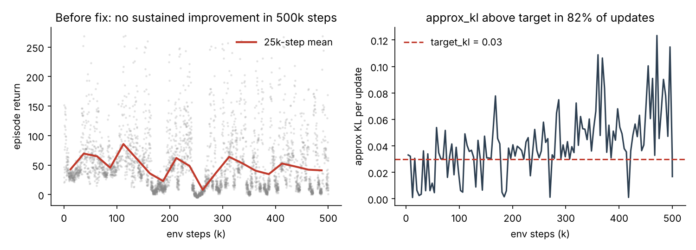

# Vision PPO Racing Arena: debugging a silent PPO failure

A PPO agent drives a [MetaDrive](https://github.com/metadriverse/metadrive) car using **only raw camera pixels**: 4 stacked 94×94 RGB frames, with no state vectors, LiDAR or hand-coded rules. The score is **route completion** on a sky-road track where leaving the road ends the episode.

The environment, reward shaping and starter PPO code come from the Vizuara Hands-on RL Bootcamp arena by Naman ([OmuNaman/vision-ppo-racing-arena](https://github.com/OmuNaman/vision-ppo-racing-arena)). **This repo documents my contribution:** finding out why training silently failed, fixing it, and adding parallel rollouts and macOS/MPS support.

---

## 1. The symptom

A 500k-step PPO run on an M-series Mac showed no sustained progress:

| env steps | mean episode return |
|---|---|
| 0–50k | 55 |
| 100–150k | **71** (peak) |
| 250–300k | 20 |
| 450–500k | 42 |



When evaluated, both saved checkpoints fell apart. The 100k-step policy reached only **5.2% route completion**: it held a near-constant action (steer −0.14, throttle 0.56) and drifted off the edge after about 43 steps. Stochastic sampling at training temperature collapsed in the same way, so this was not an eval-vs-train mismatch. A hard-coded straight-line driver reaches about 53% completion, so the track is drivable and the environment was not the problem.

## 2. The diagnosis (by measurement)

Rather than retune rewards at random, I measured where each gradient update actually went on a real rollout:

| parameter group | raw gradient norm |
|---|---|
| CNN encoder | ~2468 |
| critic head | ~1357 |
| **actor head** | **~17** |

The training loop applied one **global** `clip_grad_norm_(0.5)` across all parameters. Because the encoder and critic gradients were about 100× larger, clipping shrank everything by about 100×, which left the actor head with almost no update:

- Effective actor step per update was about 3e-7, so the actor moved about 1.7e-5 in total over 49 updates.
- Actor weights at 100k steps differed from their initial values by **< 0.002**. The policy *was* its initialization plus noise.
- The critic was badly underfit too: it predicted about 21 while returns reached 300.
- `approx_kl` exceeded `target_kl` in 82% of updates. The policy was thrashing, not learning.

**Root cause: the actor head was gradient-starved for the whole run.** Loss curves and returns looked noisy but plausible, so nothing in the standard logs pointed to this. It only showed up after measuring per-module gradient norms and weight drift.

## 3. The fix

See [`docs/actor_gradient_fix.diff`](docs/actor_gradient_fix.diff). The core change is to split the optimizer into parameter groups so each module gets a step size that matches its gradient scale:

```python
optimizer = optim.Adam([
    {"params": encoder_params, "lr": lr},
    {"params": actor_params,   "lr": lr * ACTOR_LR_MULTIPLIER},   # 8x
    {"params": critic_params,  "lr": lr * CRITIC_LR_MULTIPLIER},  # 0.2x
], eps=1e-5)
```

Other changes: `MAX_GRAD_NORM` 0.5 → 1.0, entropy coefficient 0.02 → 0.005, value coefficient 0.5 → 0.25. I also added terminal-reason and episode-completion logging, which made it clear that >90% of episodes ended in `hit_edge`.

The actor multiplier went 50 → 20 → 8. At 20 the policy was moving, but `approx_kl` spiked to about 0.11, so 8 is a stability trade-off.

## 4. Results so far

| | route completion |
|---|---|
| Original run, 100k-step checkpoint | 5.2% |
| Original run, 50k-step checkpoint | 10% |
| **Fixed run, 20k steps (MPS smoke test)** | **17%** |

After the fix, the actor head moves about **10,000× more** (0.034 weight change after 4k steps, versus 1.5e-5 over 100k steps before).

> **Status:** the full 500k-step run with the fix has not been completed yet. The 17% is from a short smoke test, not a final score. I'll update this table when the full run finishes.

## 5. Other engineering

- `parallel_env.py`: a spawn-based multi-worker MetaDrive vector env. 4 workers run at about 33 env-steps/s on CPU.
- `device.py`: CUDA → MPS → CPU auto-detection with diagnostics.
- `env.py`: an offscreen-camera workaround for macOS (Panda3D Cocoa framebuffer, MSAA off, custom RGB camera).
- Headless Linux/Kaggle rendering is still open: MetaDrive's `simplepbr` tonemapping fails to create a framebuffer without an X server.

## Run it

```bash
cd student_starter
python3.11 -m venv .venv && source .venv/bin/activate
pip install -r requirements.txt
python train_ppo.py --steps 500000 --device auto --num-envs 4 --horizon 512 \
  --minibatch 256 --epochs 3 --lr 0.0001 --target-kl 0.03 --checkpoint checkpoints/policy.pt
python eval_policy.py --checkpoint checkpoints/policy.pt
```

The reward knobs are in `reward_config.py`.

## Credit

Arena design, environment and reward shaping: Naman / Vizuara ([original repo](https://github.com/OmuNaman/vision-ppo-racing-arena)). Diagnosis, optimizer fix, parallel env, device and macOS support: Maruthi Enugula ([@morty649](https://github.com/morty649)).
